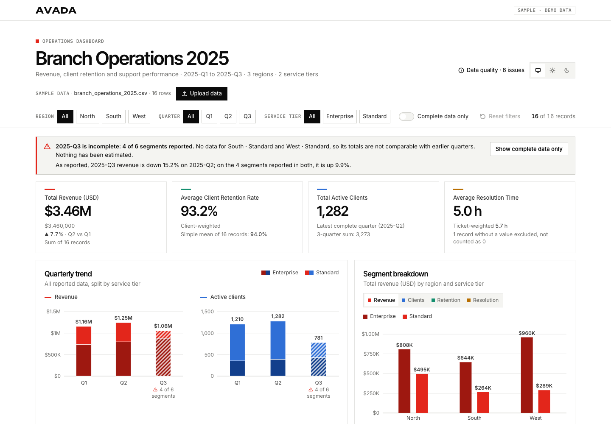
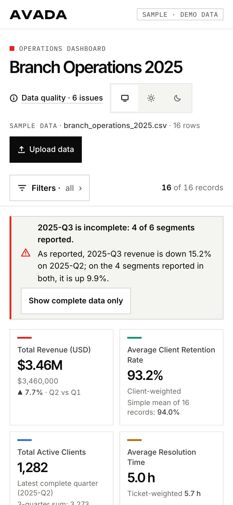

# Branch Operations Dashboard

A single-page BI dashboard over `branch_operations_2025.csv`: four KPIs, a quarterly trend, a region × tier
breakdown, global filters and a sortable summary table, built on a documented, tested data-cleaning step.

**Live demo:** https://bi.demo.avada.uz





## Run it

Requires Node.js 20+ and pnpm 10 (`corepack enable` provides pnpm).

```bash
pnpm install
pnpm dev        # clean the CSV, then start the dev server on http://localhost:5173
pnpm test       # unit tests
pnpm build      # clean the CSV, typecheck, static build in dist/
pnpm preview    # serve dist/ on http://localhost:4173
pnpm check      # typecheck + tests + build
```

`dist/` is plain static files with relative paths; it can be served from any static host or sub-path.

## Requirements

| Requirement | Implementation |
|---|---|
| Parse and clean the CSV | `src/data/clean.ts` (pure, typed, unit-tested) writes `data/clean/branch_operations_2025.json` via `pnpm data`. |
| Document data-quality issues | Generated by the same code into [`docs/DATA_QUALITY.md`](docs/DATA_QUALITY.md), `data/clean/data_quality_report.json` and the in-app **Data quality** panel. |
| 4 KPI cards | Total Revenue (USD), Average Client Retention Rate, Total Active Clients, Average Resolution Time; each with a supporting figure. |
| Quarterly trend | Revenue and active clients as two small multiples on a shared quarter axis, stacked by tier; the partial quarter is marked. |
| Region × tier breakdown | Grouped columns per region, Enterprise vs Standard, with a measure switch (revenue, clients, retention, resolution). |
| Global filters | Region, quarter and service tier, plus a **Complete data only** switch; kept in the URL so a view can be shared. |
| Sortable table | Every column sorts; group by quarter, region, tier or segment; totals row; CSV export of the current view; card layout with **Sort by** on phones. |
| One source of truth | KPIs, charts, notice and table are all derived from one filtered row set. |
| Upload data | A .csv or .xlsx with the same columns runs through the same cleaner in the browser. Nothing is sent to a server. |

Also: light and dark themes, layouts down to 360 px, full keyboard support, screen-reader summaries for each chart.

## Data cleaning

| Issue | Handling |
|---|---|
| 2025-Q3 has 4 of 6 segments (South · Standard and West · Standard missing) | Not imputed. Q3 is flagged as partial; **Complete data only** compares like for like (Q3 revenue −15.2% as reported, +9.9% on comparable segments). |
| Region casing (`north`, `WEST`) | Normalised against the known regions; unknown regions are rejected. |
| `avg_resolution_hrs = "N/A"` (record 106) | Stored as `null` and excluded from the resolution average only; the card says so. |
| Mixed precision (`6` vs `6.0`) | Parsed as numbers; display precision is set by the UI. |
| CRLF line endings, no final newline | Handled by the parser (also BOM, quoted fields, blank lines). |
| Active clients is a point-in-time count | Multi-quarter views lead with the latest complete quarter and show the sum beneath. |

Full report, with coverage grid and validation checks: [`docs/DATA_QUALITY.md`](docs/DATA_QUALITY.md). It is generated
by the code, and a test fails if it drifts from the cleaner's output.

## KPI definitions

| KPI | Definition | All data |
|---|---|---|
| Total revenue | Σ `revenue_usd` | $3.46M |
| Client retention | Client-weighted Σ(active − churned) / Σ active; simple mean of row rates shown beneath | 93.2% (94.0%) |
| Active clients | Σ `active_clients`; latest complete quarter shown for multi-quarter views | 1,282 (Q2) |
| Resolution time | Mean of `avg_resolution_hrs` over rows with a value; ticket-weighted shown beneath | 5.0 h (5.7 h) |

## Tech stack

| Layer | Choice |
|---|---|
| Build | Vite 6 (static output, no backend) |
| UI | React 18, TypeScript (strict) |
| Charts | Recharts 2 |
| Styling | Tailwind CSS 4, design tokens as CSS variables |
| Spreadsheets | SheetJS 0.20.3 (loaded only when an .xlsx is uploaded) |
| Tests | `node:test` + tsx |

## Project structure

```
data/raw/            source CSV, as received
data/clean/          cleaned records and report (generated)
docs/                DATA_QUALITY.md (generated), screenshots
scripts/build-data.ts  raw CSV -> clean JSON + report
src/data/            parser, cleaner, report, upload
src/lib/             metrics, formatting, URL state, theme
src/components/      dashboard sections
src/ui/              shared UI primitives
tests/               unit tests
```

## Testing

105 tests (`pnpm test`):

- **Cleaning** — CSV parsing edge cases, normalisers, every issue in the real file, rejection of bad input, duplicates.
- **Metrics** — KPIs against values computed independently from the raw CSV, filters, like-for-like, trend, breakdown, table grouping and sorting.
- **Outputs** — committed JSON and `DATA_QUALITY.md` match the cleaner.
- **Upload** — .csv and .xlsx through the same cleaner, clear errors for bad files, persistence.
- **Interface** — number formatting, labels, table and phone layout, CSV export, URL state, theme colours and contrast.

## Effort

6 hours.

---

Built by **Avada** · [avada.uz](https://avada.uz) · © 2026 Avada. All rights reserved.
